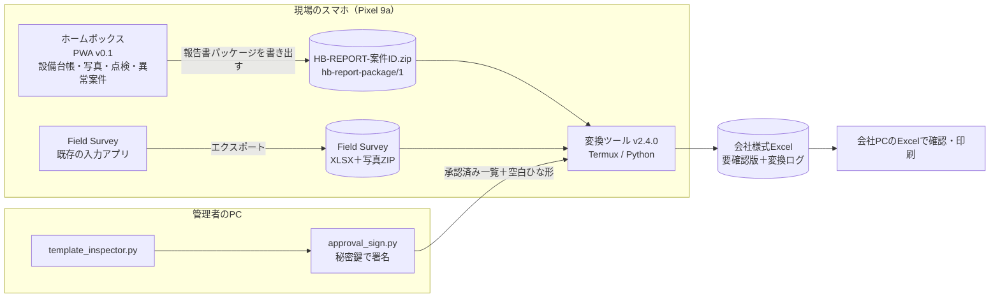

# ホームボックス 全体構成（2026-11-07）

## 1. ひとことで

**ホームボックスが「情報の中心」、変換ツールが「報告書を作る専用エンジン」。**
両者はサーバーを使わず、**ファイル1つ（報告書パッケージ）**で受け渡す。

## 2. 役割分担

| 機能 | ホームボックス | 変換ツール | Field Survey |
|---|---|---|---|
| 17項目設備台帳（値ごとに確認状況と出典） | **正**として管理 | 受け取るだけ | — |
| 撮影・写真の保管（原本のまま、規則で命名） | **管理** | 縮小して様式に貼る | 移行期間のみ |
| 点検・測定の記録 | **管理** | — | — |
| 異常案件・対応経過 | **管理**（Field Surveyと同じ項目名） | 受け取る | 移行期間のみ |
| 会社様式Excelの生成 | 依頼（パッケージを書き出す） | **実施** | — |
| ひな形の承認・安全検査 | — | **実施**（署名検証・部品検査） | — |

移行期間は、Field Survey の書き出しもそのまま変換できる（v2.3 系と同じ入口）。

## 3. 共通ID

| ID | 形式 | 付ける場所 | 不変 |
|---|---|---|---|
| 設備ID | `EQ-000001`（会社台帳の番号をCSVで取り込めばそれを使う） | ホームボックス | 変えない・使い回さない |
| 案件ID | `CASE-YYYYMMDD-NNNN` | ホームボックス（Field Surveyは自動ID） | 変えない |
| 写真ID | `PH-…`（内部）／ファイル名 `案件ID_設備ID_連番_種別.jpg` | ホームボックス | 変えない |
| 承認ID | `APV-YYYYMMDD-…` | 管理者の署名ツール | — |

機器番号・設備名・場所は**変わってよい属性**で、IDとは分けて持つ。QRは任意（中身は設備IDだけ）。

## 4. データの置き場所と流れ

- ホームボックスのデータは**端末のブラウザの中（IndexedDB）だけ**。アプリは外部に通信しない（CSPで `connect-src 'self'`、外部フォント・外部ライブラリなし）。
- 端末の外に出るのは、利用者が明示的に書き出したファイルだけ：
  1. 報告書パッケージ（変換ツールへ）
  2. バックアップZIP（会社が認めた保存先へ）
  3. 台帳CSV（会社台帳との突き合わせ）
- 変換ツールはパッケージ・ひな形・承認一覧を**読むだけ**。出力は常に新しいファイル。

## 5. 安全の仕組み（どこで何を止めるか）

| 段階 | 止める条件 | 実装 |
|---|---|---|
| ホームボックスで書き出す前 | 必須項目の空欄、写真4枚以上、説明文なし、同じ画像の重複、対応経過9件以上 | `caseProblems()` |
| パッケージを読むとき | 形式違い、知らない項目、写真の改ざん（SHA-256）、写真の不足・余分、不正なファイル名 | `homebox_adapter.py` |
| ひな形を使う前 | 署名がない・合わない、未登録/失効した鍵、原本の1バイトの違い、変換ツールの変更範囲の変化、期限切れ | `approval.py` |
| 変換した後 | 変更禁止部品の変化、許可外セルの変化、部品の追加、過去案件の文字・作成者名の残留、写真のEXIF | `verify_output_against_approval()` |
| 提出前 | 人による確認・印刷確認 | 運用 |

## 6. 会社の承認で確認しておくこと

承認を得たとのことなので、範囲を記録として残しておく（後で揉めないため）。

- [ ] 個人端末（Pixel 9a）で業務写真を撮影・保存してよい／会社端末を使う
- [ ] ホームボックスに会社の設備台帳（19台）を取り込んでよい
- [ ] バックアップZIPの保存先（会社の共有フォルダー等）
- [ ] Googleフォト・Androidバックアップの対象からホームボックスと Download を外す設定
- [ ] Termux と変換ツールの業務利用、会社PCでの確認手順
- [ ] 空白ひな形の承認者（秘密鍵を持つ人）と、公開鍵一覧の配布担当
- [ ] 設備へのQRラベル貼付（する場合）
- [ ] アプリのホスティング先（GitHub Pages で公開URLになる点を含む）

## 7. ホスティング

- `homebox-app/` は静的ファイルだけ。GitHub Pages などHTTPSで配信し、Pixel の Chrome で開いて「ホーム画面に追加」。
- 同じサイトの親フォルダーにある「電気の疑問図鑑」のサービスワーカーとは**スコープを分けている**（`homebox-app/sw.js` がこのフォルダーを担当）。
- コードに業務データは含まれない。業務データは各端末の中だけにある。

## 8. この先（大きい順）

1. **Pixel 9a での実地テスト**：架空の設備1台で「撮る→案件→書き出し→変換→PCで印刷」を一周。
2. **空白ひな形の承認**：管理者が 承認手順書_管理者向け.md の手順で署名。
3. **会社台帳19台の取り込み**：台帳CSVで取り込み、現地で「確認済」に上げていく。
4. **17項目の確定**：正式テンプレートで（仮）の7項目を確定（`FIELDS` の1か所を直すだけ）。
5. **v0.2**：場所の階層、点検周期と未実施の一覧、写真4枚以上の複数ページ、銘板OCR（候補を人が確認）。
6. **将来**：変換エンジンをアプリ内に移す（Kotlin/JS移植）と、Termuxを介さずワンタップで報告書になる。承認の仕組み（署名・部品検査）はそのまま移す。
